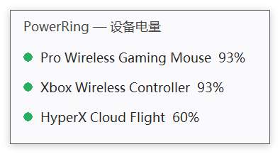

# PowerRing

> English: [README.en.md](README.en.md)

Windows 无线外设电量监测。托盘里一圈电量环，一眼看清鼠标、耳机还剩多少电 —— 不用为每个品牌装一个厂商软件。

- **单文件 exe，约 0.9 MB**，免安装、不需要管理员权限
- **不联网、无账号、无遥测**，所有数据留在本机
- **加一台设备 = 加一份 YAML**，不需要改代码（详见 [加一台设备](#加一台设备)）




## 现在能做什么

| 功能    | 说明                                                           |
| ----- | ------------------------------------------------------------ |
| 托盘电量环 | 缺口大小对应剩余电量。绿 → 黄 → 红表示由高到低，充电时转蓝；**读不到时显示灰环，绝不用 0% 表示「读不到」** |
| 悬停看数字 | 鼠标停在图标上显示各设备百分比；多台时用短名，按电量从低到高排                              |
| 左键点击  | 开/关电量面板，列出每台设备的完整名字与电量                                       |
| 右键菜单  | 显示电量面板 / 立即刷新 / 设置… / 退出                                     |
| 低电量提醒 | 跨过阈值才弹一次，每档只弹一次，卡片锚在托盘旁边，不用去找它在哪                             |
| 开机自启  | 写 `HKCU\...\Run`，不需要提权；同一个互斥量保证不会冒出第二个托盘图标                   |
| 界面配色  | 跟随系统 / 浅色 / 深色三态。任务栏是深色而应用是浅色时，可以单独强制深色                      |
| 自动发现  | 总线每 60 秒重扫一遍：中途开机的设备自己进来。关机的会在十几秒到半分钟内退下去，不挂着旧电量骗人；**刚有设备消失的那 3 分钟里节奏压到 10 秒一轮**，它一重开立刻出现 |
| 日志    | `%APPDATA%\PowerRing\log.txt`，超过 1 MB 滚动                     |

设置窗口里可以调刷新间隔、警告阈值与严重阈值、提醒开关（带「试一次」按钮，改完当场验证）、开机自启、界面配色。

## 已验证的设备

| 设备                      | 接口                                                        | 电量来源                              | 状态                                |
| ----------------------- | --------------------------------------------------------- | --------------------------------- | --------------------------------- |
| Logitech G PRO Wireless | 接收器 `046D:C539`，usage page `FF00` / usage `0002`，slot 1–6 | HID++ 2.0 `0x1001` 电压式（mV → 放电曲线） | 已验证。与 G HUB 对照偏差 ±1% |
| Logitech G PRO Wireless（插线时） | **有线** `046D:C088`，usage page `FF00` / usage `0002` | 同一个 feature `0x1001` | 已验证。4101 mV 读 93%，同时正确显示为充电中 |
| HyperX Cloud Flight（天箭） | 接收器 `0951:1723`，usage page `FF90` / usage `0303`          | 私有报文 `21 FF 05`（接收器直连模式）          | 已验证读数稳定一致（数值 231 读 60%）；官方软件不显示百分比，无外部基准可对照 |
| Xbox 无线手柄（Series） | **蓝牙**，VID `045E` / PID `0B13`                    | 蓝牙标准电池服务 `0x180F` / `0x2A19`      | 已验证。与 Windows 蓝牙设置页面读数一致（高位 93%、低位 12% 都对过） |

### 读数准不准

一句话：**蓝牙设备与自报百分比的设备，读数和系统同源，逐个字节都对得上；只有「读电压再换算」这一类会有 ±1% 的抖动。**

| 设备类型 | 谁说了算 | 准到什么程度 |
| --- | --- | --- |
| 蓝牙设备（Xbox 手柄） | 设备自报百分比 | 与 Windows 蓝牙设置页面**同源同值**。高低两端都对照过，完全一致 |
| 直接读百分比的设备 | 设备自报 | 同上，读到什么就是什么 |
| 电压式设备（GPW） | 本程序查放电曲线换算 | 与 G HUB 对照**偏差 ±1%，且方向不固定** —— 高电量时本程序高 1，低电量时低 1 |

第三类那 ±1% 没有修，是有理由的：**它不是一条能整体挪掉的偏差**。方向会翻转，说明问题不在这条曲线偏移了多少，而在两侧采样时刻不同、加上各自插值与取整方式不同。为迁就一台设备去挪这条曲线，会让这条通用基线对其它罗技设备失去意义。真要较真：把鼠标静置几分钟，两边对着同一个瞬间读。

顺带说一句天箭：**它的 `verified` 不含「与厂读数对照过」这一层** —— HyperX 官方软件 NGENUITY 根本不显示具体百分比，无从对照。这一条在 `devices/hyperx_cloud_flight.yaml` 里也写明了，免得后来人以为漏做了。

**Xbox 手柄那一类不需要逆向**：蓝牙 SIG 把「读电池」定成了公开标准，只要设备照着做，
按标准 UUID 读就行，声明里连一个字节的报文都不用写。想看看本机有哪些这类设备：

```bash
cargo run --release --example ble_probe
```

这条命令会列出本机所有带标准电池服务的蓝牙设备，顺带打出**每台的连接状态**，
以及两种读法的结果：

- `实时读` —— 真的往设备发一次 GATT 请求，拿当下这个值
- `缓存读` —— 取系统缓存里那份，可能是几分钟前同步的

**主程序优先走实时读**，只有在那一刻读不到时才退到缓存。拿它和系统蓝牙设置页面对照时，
两者读的是同一份 GATT，所以数值同源；差别在于设置页面显示的是它上次同步时的值，
设备电量刚变过的话，实时读会比它更新。

> 如果它打印「找到 0 个设备」，先别怀疑脚本：这表示**此刻**没有既已连接、
> 又暴露标准电池服务的蓝牙设备 —— 手柄没开机、没配对、或者只连了 USB 线都算。
> 把设备用蓝牙连上再跑一次。

设备声明在 `devices/` 下，每份 YAML 都写了 `protocol_source`（协议常量出处）与 `verification`（是否已上真机验证）。**没上过机的一律标 `unverified`，不会被当作可信数据。**

## 用法

下载 Release 里的 zip，解压到任意目录（比如 `C:\Tools\PowerRing`），双击 `powerring.exe` 即可。目录结构必须是 exe 与 `devices` 平级：

```
PowerRing/
├─ powerring.exe
└─ devices/
   ├─ logitech_gpw.yaml           # 无线（接收器）
   ├─ logitech_gpw_wired.yaml     # 插线时
   ├─ hyperx_cloud_flight.yaml
   └─ xbox_controller.yaml
```

> Windows 10 会把新托盘图标折叠进通知区域的 `^` 里。如果没看到，去「任务栏设置 → 通知区域 → 选择哪些图标显示在任务栏上」把它打开。

## 加一台设备

复制 `devices/` 下最接近的一份 YAML 改几行即可，**不需要改 Rust 代码**。三种写法：

**蓝牙标准设备**（手柄、部分键盘）只需要 VID/PID，连报文都不用：

```yaml
protocol: "ble"
transport: "direct"
match:
  vendor_id: "0x045E"
  product_id: "0x0B13"   # 蓝牙模式下的产品号
battery:
  kind: "percent"        # 标准 Battery Level 读出来就是百分比
```

**HID++ 2.0 设备**（罗技系）走「feature 号 + 取值方式」：

```yaml
name: "Logitech G PRO Wireless"
short: "GPW"              # 托盘悬停用；不填就用全名
protocol: "hid++2.0"
transport: "receiver"     # 经接收器按 slot 寻址；设备直连用 "direct"

match:                    # 匹配哪个 HID 接口
  vendor_id: "0x046D"
  product_id: "0xC539"
  usage_page: "0xFF00"
  usage: "0x0002"

slots: [1, 2, 3, 4, 5, 6] # 接收器上要探测哪些槽位，省略默认 1..6
battery:
  feature: "0x1001"       # 电量 feature
  kind: "voltage"         # voltage = 读 mV 换算；percent = 读出来就是百分比
identify:                 # 同一个接收器上可能挂着别的设备，用它做二次确认
  name_feature: "0x0005"
  contains: "PRO WIRELESS"
protocol_source: "Logitech HID++ 2.0，常量参考 Solaar（GPL-3.0）公开文档"
verification: "verified"
```

**非 HID++ 设备**走 `raw`：把「发什么报文、读哪几个字节、怎么换算」全部写进声明。下面是 HyperX 天箭的真实配置，它没有一行 Rust 代码被改动就接进来了：

```yaml
protocol: "raw"
transport: "direct"
match:
  vendor_id: "0x0951"
  product_id: "0x1723"
  usage_page: "0xFF90"
  usage: "0x0303"
battery:
  request: "21 FF 05"     # 请求报文，首字节是 report id
  reply_len: 20           # 很多设备对长度敏感，短了干脆不回
  state_index: 3          # 响应里「档位」字节的下标
  value_index: 4          # 响应里「数值」字节的下标
  charging_states: ["0x10", "0x11"]
  table:                  # 分段换算表：数值落在哪一段取哪个百分比
    "0x0e":
      - [89, 10]
      - [239, 60]
      - [255, 65]
    "0x0f":
      - [19, 70]
      - [129, 95]
      - [255, 100]
```

用分段表而不是公式：这些设备的原始数值与百分比**不是线性关系**，线性拟合在高电量段能差出十几个百分点。

完整字段说明与手把手抓包流程见 [docs/adding-a-device.md](docs/adding-a-device.md)。想把自己的设备贡献进来，直接用仓库里的 Issue 模板提。

## 构建

需要 Rust 工具链（Windows 默认 `x86_64-pc-windows-msvc`，依赖 VS 2022 生成工具）。

```bash
cargo build --release
```

产物：`target/release/powerring.exe`（约 0.9 MB）。

## 已验证的协议事实

**罗技 G PRO Wireless**（HID++ 2.0）

- 不支持 `0x1004` 统一电量，只有 `0x1001` 电压式
- 长报文必须写满 **20 字节**，短报文固定 **7 字节**，长度不对设备不响应或回 `0x8F`
- 判断接收器 slot 有没有设备要用 `getFeature`，**不能用 ping**
- 电压读数有约 1 mV 抖动 —— 代码侧做了滞回平滑，变化不足 2 个百分点不更新
- HID 报文里的设备名是定长加 `0x00` 填充的，`trim()` 不会去掉 NUL

**HyperX Cloud Flight**

- 接收器暴露 4 个接口，**只有 `FF90:0303` 会回应电量请求**，其余三个（`000C:0001` / `FF00:0001` / `FFC0:0001`）发了没反应 —— 探测时别只试一个
- 耳机没开机时探测无响应，程序会正确地把它排除掉，而不是显示 0%
- 请求报文的 report id 是 `0x21`，比常见的 `0x00`–`0x10` 都大，逐个试的时候容易漏

## 已知限制

- **蓝牙设备是支持的，但有前提**：必须是走标准 Battery Service 的那类（手柄、部分键盘）。
  AirPods 这类走私有协议的读不到 —— 它们的电量本来也由系统自己展示
- Xbox 手柄**只有蓝牙模式**读得到：USB 有线不走 GATT，无线适配器走微软私有 GIP 协议
- 蓝牙 Battery Level 只有一个百分比字节，**没有「是否在充电」这一位**，所以这类设备不会显示充电状态
- **蓝牙设备按「此刻连着没有」进出列表**：断连就退下去，重连自动回来，不会出现
  「手柄没电关机了托盘还挂着它」。取不到实时值时退回系统缓存里那份（可能陈旧），
  但不至于让正在用的设备凭空消失
- 读不到电量时显示灰环，不会猜一个数

想让更多设备被认出来，或者想改代码，从这三处进：

| 想做什么 | 从哪开始 |
| --- | --- |
| 加一台自己的设备 | [docs/adding-a-device.md](docs/adding-a-device.md)，不用会写代码；只想提供数据也可以，Issue 模板里有位置 |
| 改代码、提 PR | [CONTRIBUTING.md](CONTRIBUTING.md)：怎么跑起来、代码要求、PR 格式 |
| 报告安全问题 | [SECURITY.md](SECURITY.md)：走 GitHub Security Advisory 私下说，别开公开 Issue |

## 许可证红线

协议常量与报文格式属于事实信息，可以移植；**禁止直接复制** Solaar / HeadsetControl / OpenRazer 等 GPL 项目的源码。每份设备声明都必须填写 `protocol_source` 注明出处；引用 GPL 项目时只允许把常量当事实抄进来，不允许引用其代码。

本项目自身采用 **MIT**，见 [LICENSE](LICENSE)。
